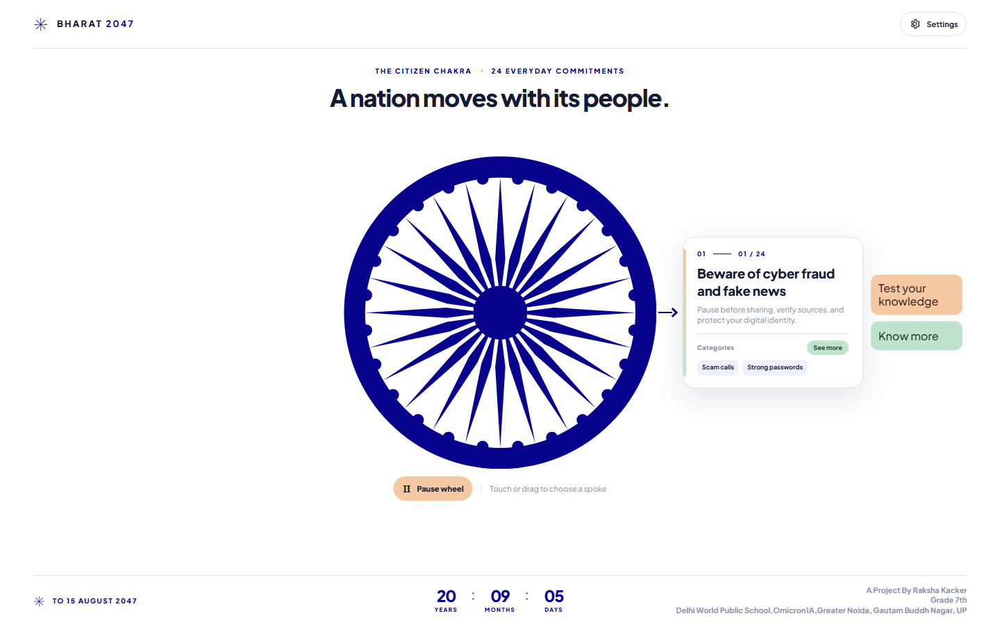
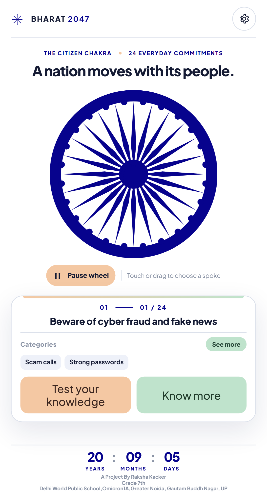

# Bharat 2047 · The Citizen Chakra

An interactive web app about 24 everyday commitments that citizens can make toward a developed India by 15 August 2047. The central wheel uses the supplied Ashoka Chakra SVG and points to one commitment at a time.

**Live site:** [mybharatat2047.web.app](https://mybharatat2047.web.app)

## Screenshots

### Desktop



### Android-sized screen



## Features

- A 24-spoke Chakra that advances clockwise once a second, can be paused, and can be turned by touch, pointer, or arrow keys.
- A selected commitment panel with categories, **See more / See less**, **Test your knowledge**, and **Know more**.
- A 24-question test for each commitment, mixing multiple-choice and written responses. Answers are saved on the device.
- A topic page covering the problem, a common myth, practical actions, and habits to avoid.
- English, Hindi, and Urdu interfaces, plus light/dark appearance and wheel sound controls in Settings.
- A countdown to 15 August 2047 and layouts for desktop, tablet, and phone screens.

## Run locally

The site is plain HTML, CSS, and JavaScript. Node.js is only needed to assemble the Firebase Hosting folder.

```bash
npm run build
```

Serve `dist/` with any static HTTP server, then open `index.html`. For example, with Python:

```bash
python -m http.server 8000 --directory dist
```

Open <http://localhost:8000>. No package installation is required for the build.

## Deploy to Firebase Hosting

The Firebase project and hosting directory are set in `.firebaserc` and `firebase.json`.

```bash
npm run build
firebase deploy --only hosting --project mybharatat2047
```

The Firebase CLI must be installed and signed in to an account with access to the project. Run the build after changing a source file; `dist/` is generated and intentionally omitted from Git.

## Project files

- `index.html`, `styles.css`, `app.js`: interactive home page and wheel.
- `test.html`, `learn.html`, `topic-pages.css`, `topic-pages.js`: test and learning pages.
- `topic-data.js`, `topic-categories.js`, `i18n.js`: commitments, categories, and translations.
- `settings.js`, `settings.css`: appearance, sound, and language settings.
- `Ashoka_Chakra.svg`: the Chakra image supplied for this project.
- `firebase-init.js`: Firebase Analytics initialization using Hosting's runtime configuration.

## Project credit

A Project By Raksha Kacker<br>
Grade 7th<br>
Delhi World Public School,Omicron1A,Greater Noida, Gautam Buddh Nagar, UP
